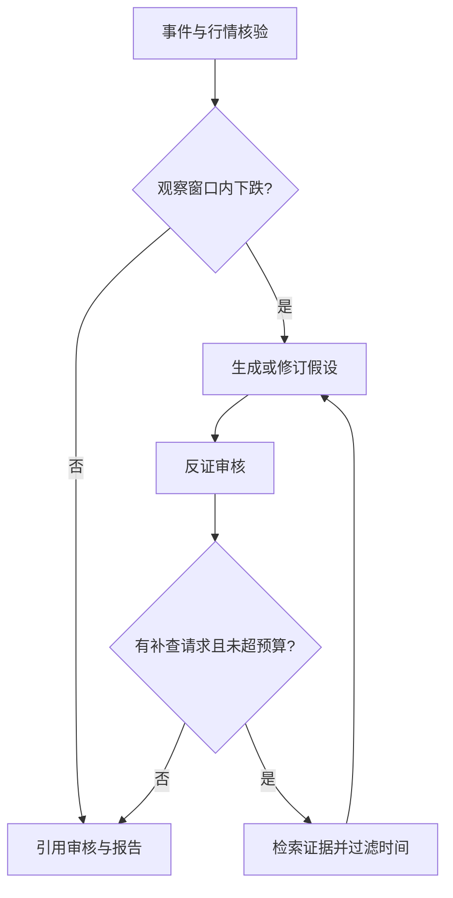

# MAIA — Market Anomaly Investigation Agent

FTEC5660 项目：调查“公司发布正面消息，但股价下跌”的事件，输出候选解释、支持证据、反证和信息缺口。

已有 DeepSeek 密钥时，在项目根目录只输入公司和目标日期：

```powershell
.\.venv\Scripts\python.exe -m maia.cli --company "NVIDIA" --date 2025-02-25
```

支持 SEC 目录中的美股代码和英文公司名，以及部分中文别名（如「英伟达」）。公司名对应多个股类时，请用股票代码。日期按纽约时间解释。

程序自动查找目标日期前后各 365 天内的 SEC 8-K／6-K 披露，并下载股票与基准的日收盘价。按披露日期与目标日期的日历天数差排序，同距离优先较早的披露。对每个候选，用披露前最后一次收盘和披露后第一次收盘计算收益，自动处理盘后披露、周末和提前收市。只有股价下跌时，才下载 SEC 披露及其 HTML 附件，由 DeepSeek 判断是否包含实质正面事实，并核对支持该判断的原文。找到第一条符合条件的事件后，开始完整调查。

输出目录包含 `report.md` 与 `state.json`。它们记录候选筛选、最终事件、出处、实际用于推理的证据、反证审核及 token 用量。未找到符合条件的事件时，仍生成筛选报告。行情或披露缺失的候选会明确标出。

这个入口覆盖可获取的 SEC 8-K／6-K 及 HTML 附件。它使用备案接收时间作为事件时间，媒体或公司网站可能更早发布。自动模式默认识别为本项目。SEC 拒绝访问时，可以在 `.env` 中配置 `SEC_USER_AGENT` 项目名和联系邮箱。搜索最远到运行当天，只分析已完成的价格窗口。

## 快速开始（Windows PowerShell）

可在项目根目录运行一键安装与验证脚本，无需激活虚拟环境：

```powershell
powershell -NoProfile -ExecutionPolicy Bypass -File .\setup.ps1
```

脚本会创建或复用 `.venv`，安装项目依赖，检查依赖冲突，运行全部测试，最后生成演示报告并记录 `requirements.lock.txt`。任一步失败立即停止。若执行环境不允许联网，请在本机 PowerShell 中运行此命令；更换文件夹并不会自动解除网络限制。
之后可使用 `powershell -NoProfile -ExecutionPolicy Bypass -File .\run-demo.ps1` 再次运行演示。

在项目根目录运行，使用 Python 3.10 或以上：

```powershell
python -m venv .venv
.\.venv\Scripts\python.exe -m pip install -e .
.\.venv\Scripts\python.exe -m unittest discover -s tests -v
```

演示不需要 API Key。`DEMO` 公司、行情和全部证据均为虚构；推理使用固定脚本，仅验证工程闭环，不代表模型效果。
输出位于 `runs/<案例ID_时间>/report.md` 和 `state.json`，后者保存实际使用的证据、各节点输出、运行配置和审核问题。

## 使用 DeepSeek 官方 API

在 [DeepSeek 开放平台](https://platform.deepseek.com/api_keys) 创建 API Key。若项目根目录还没有 `.env`，先执行以下命令，再用编辑器将密钥填入 `DEEPSEEK_API_KEY=` 后面。也可以直接设置同名环境变量。

```powershell
if (-not (Test-Path .env)) { Copy-Item .env.example .env }
```

保存 `.env` 后，运行一次调查和反证审核：

```powershell
.\.venv\Scripts\python.exe -m maia.cli examples/synthetic_earnings.json --max-rounds 0
```

默认模式为 `deepseek`，直接调用 `https://api.deepseek.com/chat/completions`。默认模型为 `deepseek-flash`，可通过 `DEEPSEEK_MODEL=deepseek-v4-pro` 切换。上面的命令使用虚构案例测试真实 API，会发送已检索且在时间窗口内的证据并按 DeepSeek 的规则计费。缺少密钥或 API 请求失败时，程序会报错退出。

使用 `--mode demo` 可运行无需密钥的固定脚本。已有的通用接口模式 `--mode api` 仍读取 `MAIA_API_KEY`、`MAIA_MODEL` 和可选的 `MAIA_BASE_URL`。

## 调查流程



默认最多两轮补查，每轮最多三个查询。找到新证据时，DeepSeek 重新推理并执行反证审核；没有新证据时提前结束。`--max-rounds 0` 禁止补查，`--no-countercheck` 跳过反证审核。

`--baseline` 对同一案例在一次模型推理中提供全部截止时间前的输入证据，跳过补查和反证审核。用它对照完整流程的引用覆盖、候选解释和 token 用量：

```powershell
.\.venv\Scripts\python.exe -m maia.cli examples/nvda_fy2025_q4.json --baseline
```

每次 API 调用有超时、输出长度与重试上限。实际账单以 DeepSeek 为准。

## 代码入口

| 文件 | 职责 |
| --- | --- |
| `src/maia/models.py` | 案例、价格窗口、证据、假设与查询的结构校验 |
| `src/maia/providers.py` | 证据工具协议与本地关键词检索实现 |
| `src/maia/discovery.py` | 根据公司和日期发现 SEC 披露，用行情及披露原文筛选 |
| `src/maia/market.py` | SEC 财报公告与美国股票、基准日收盘价采集 |
| `src/maia/reasoning.py` | 演示推理与模型 API 适配、反证审核提示词 |
| `src/maia/graph.py` | LangGraph 状态、条件路由、补查循环、引用检查 |
| `src/maia/report.py` | 确定性 Markdown 报告 |
| `src/maia/cli.py` | 命令行配置和运行结果保存 |
| `examples/synthetic_earnings.json` | 可直接运行的虚构案例，含一条应排除的未来证据 |
| `tests/test_investigation.py` | 时间泄漏、引用伪造、循环边界和事件退出测试 |

## 复现旧案例与指定事件

可以直接传入预备案例 JSON。复制 `examples/nvda_fy2025_q4.json`，替换股票、公告、同一交易窗口的股票与基准价格，以及带时区和来源的证据。正面消息由用户填写，引用需在截止时间内，模型会区分同比增长与超市场预期。

也可以从指定的美国上市公司财报公告自动建立案例。按 `examples/nvda_fy2025_q4_event.json` 填写 SEC CIK、accession 和财报附件名、前后两个交易日的纽约时间 16:00 以及调查截止时间。在 `.env` 添加 `SEC_USER_AGENT=MAIA 你的联系邮箱`，然后运行：

```powershell
.\.venv\Scripts\python.exe -m maia.cli --event examples/nvda_fy2025_q4_event.json
```

程序用 SEC 备案接收时间定位事件，从财报附件提取证据，并从 Yahoo Finance 下载相同两个交易日的股票和基准收盘价。两者均按 Close 列计算价格涨跌，不含现金分红收益。提前收市日也以纽约 16:00 作为保守的日数据可用时间。外部源拒绝访问或缺少交易日数据时会报错，可以改用预备案例。补充新闻可填在输入的 `evidence` 中，系统会在提供给模型前过滤晚于截止时间的材料。

## 已实现与下一步

当前提供单一公司的自动事件发现和命令行调查。补查检索已下载的备案附件和案例提供的证据，新闻可手工加入。候选解释按引用支持数量排序，引用内容与因果方向仍需人工审查。基准收益差是简单差值。

全市场自动发现、通用新闻检索、Web 界面、断点恢复和人工评分集属于后续扩展。

技术参考：
- https://docs.langchain.com/oss/python/langgraph/overview
- https://docs.langchain.com/oss/python/langgraph/quickstart
- https://github.com/TauricResearch/TradingAgents （业务角色参考；本项目未复制其代码）
