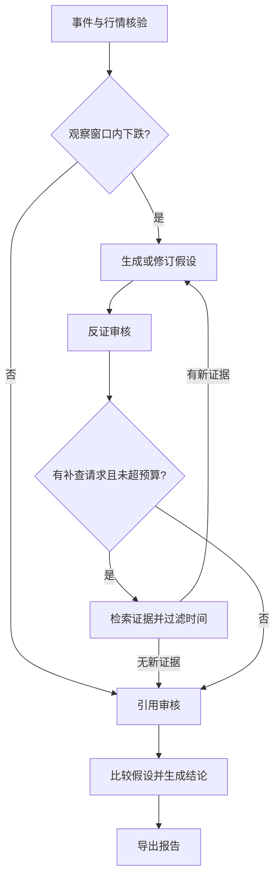

# MAIA — Market Anomaly Investigation Agent

MAIA 是 FTEC5660 的美股事件调查项目。输入公司和目标日期，程序会自动寻找最近的「披露含正面消息，但股价下跌」事件。报告给出首选解释、证据与反证，以及最可能改变判断的证据缺口。

已有 DeepSeek 密钥时，在项目根目录只输入公司和目标日期：

```powershell
.\.venv\Scripts\python.exe -m maia.cli --company "NVIDIA" --date 2025-02-25
```

支持 SEC 目录中的美股代码和英文公司名。公司名对应多个股类时，请用股票代码。日期按纽约时间解释。

程序自动查找目标日期前后各 365 天内的 SEC 8-K／6-K 披露，并下载股票与基准的日收盘价。按披露日期与目标日期的日历天数差排序，同距离优先较早的披露。对每个候选，用披露前最后一次收盘和披露后第一次收盘计算收益，自动处理盘后披露、周末和提前收市。只有股价下跌时，才下载 SEC 披露及其 HTML 附件，由 DeepSeek 判断是否包含实质正面事实，并核对支持该判断的原文。找到第一条符合条件的事件后，开始完整调查。

输出目录包含面向读者的 `report.md` 和用于复查的 `state.json`。运行完成后，终端会打印报告路径。未找到符合条件的事件时，仍会生成筛选报告，标明行情或披露缺失的候选。

这个入口覆盖可获取的 SEC 8-K／6-K 及 HTML 附件。它使用备案接收时间作为事件时间，媒体或公司网站可能更早发布。自动模式默认识别为本项目。SEC 拒绝访问时，可以在 `.env` 中配置 `SEC_USER_AGENT` 项目名和联系邮箱。搜索最远到运行当天，只分析已完成的价格窗口。

## 快速开始（Windows PowerShell）

可在项目根目录运行一键安装与验证脚本，无需激活虚拟环境：

```powershell
powershell -NoProfile -ExecutionPolicy Bypass -File .\setup.ps1
```

脚本会创建或复用 `.venv`，安装项目依赖，检查依赖冲突，运行全部测试，最后生成演示报告并记录 `requirements.lock.txt`。任一步失败立即停止。若执行环境不允许联网，请在本机 PowerShell 中运行此命令；更换文件夹并不会自动解除网络限制。
之后可使用 `powershell -NoProfile -ExecutionPolicy Bypass -File .\run-demo.ps1` 再次运行演示。

在项目根目录运行，使用 Python 3.10 或以上：

```powershell
python -m venv .venv
.\.venv\Scripts\python.exe -m pip install -e .
.\.venv\Scripts\python.exe -m unittest discover -s tests -v
```

演示不需要 API Key。`DEMO` 公司、行情和全部证据均为虚构；推理使用固定脚本，仅验证工程闭环，不代表模型效果。
输出位于 `runs/<案例ID_时间>/report.md` 和 `state.json`，后者保存实际使用的证据、各节点输出、运行配置和审核问题。

## 使用 DeepSeek 官方 API

在 [DeepSeek 开放平台](https://platform.deepseek.com/api_keys) 创建 API Key。若项目根目录还没有 `.env`，先执行以下命令，再用编辑器将密钥填入 `DEEPSEEK_API_KEY=` 后面。也可以直接设置同名环境变量。

```powershell
if (-not (Test-Path .env)) { Copy-Item .env.example .env }
```

保存 `.env` 后，可用虚构案例快速验证分析、反证审核和结论调用：

```powershell
.\.venv\Scripts\python.exe -m maia.cli examples/synthetic_earnings.json --max-rounds 0
```

默认模式为 `deepseek`，直接调用 `https://api.deepseek.com/chat/completions`。默认模型为 `deepseek-flash`，可通过 `DEEPSEEK_MODEL=deepseek-v4-pro` 切换。上面的命令使用虚构案例测试真实 API，会发送已检索且在时间窗口内的证据并按 DeepSeek 的规则计费。缺少密钥或 API 请求失败时，程序会报错退出。

使用 `--mode demo` 可运行无需密钥的固定脚本。已有的通用接口模式 `--mode api` 仍读取 `MAIA_API_KEY`、`MAIA_MODEL` 和可选的 `MAIA_BASE_URL`。

## 调查流程



默认最多两轮补查，每轮最多三个查询。找到新证据时，DeepSeek 重新推理并执行反证审核；没有新证据时提前结束。`--max-rounds 0` 禁止补查，`--no-countercheck` 跳过反证审核。

补查引出的新假设必须引用本轮新增且通过时间过滤的证据，并分别给出什么结果会支持或削弱它。已有假设沿用原编号。后续查询须关联一个仍在调查的假设，重复查询会被跳过。新增假设沿用原有轮次和查询预算。报告与 `state.json` 会保存新假设的触发证据、出现轮次、检验条件及预算内来不及执行的查询。当前补查仍检索本地案例材料。

报告的 `Conclusion` 在引用审核之后生成。DeepSeek 比较证据的直接性和相关性，选出当前最值得追查的假设，列出参考证据及最可能改变判断的缺口。即使归因仍为 `inconclusive`，报告也可以指出最有依据的线索。没有有效支持引用或综合结果未通过校验时，报告不会指定首选。结论也保存在 `state.json` 中。

阅读报告时，先看 `Conclusion` 中的首选解释、归因状态和关键缺口，再去 `Candidate explanations` 对照其他假设，按证据编号到 `Evidence ledger` 查原文。若补查引出了新假设，`Hypotheses raised by new evidence` 会列出触发证据和检验条件。`state.json` 还保留候选筛选、逐步执行轨迹、未完成的补查和模型用量。

`--baseline` 对同一案例在一次模型推理中提供全部截止时间前的输入证据，跳过补查、反证审核和比较结论的额外模型调用。用它对照完整流程的引用覆盖、候选解释和 token 用量：

```powershell
.\.venv\Scripts\python.exe -m maia.cli examples/nvda_fy2025_q4.json --baseline
```

每次 API 调用有超时、输出长度与重试上限。实际账单以 DeepSeek 为准。

## 真实案例验证

下面是已跑通的公司和目标日期。将任一行的代码和日期代入快速开始命令即可复现，模型生成的假设编号和措辞可能变化。

| 公司 | 目标日期（纽约时间） |
| --- | --- |
| Meta（META） | 2024-04-23 |
| NVIDIA（NVDA） | 2025-02-25 |
| Tesla（TSLA） | 2025-07-22 |
| Microsoft（MSFT） | 2025-01-28 |
| Alphabet（GOOGL） | 2025-02-03 |
| Amazon（AMZN） | 2025-02-05 |

在把「首选解释」与「归因状态」分开之前，这六个真实案例的结论都为 `inconclusive`。主要缺口是缺少公告前带时间戳的市场预期，部分案例也缺同行或盘中行情。这个小样本不能用来估计总体归因成功率。

新版完整重跑 Meta，选中了 2024 年 4 月 24 日盘后的财报。财报披露净利润同比增长 **117%**，META 下一交易日收盘跌 **10.56%**，同期 SPY 跌 **0.38%**。报告优先追查上调费用与资本开支指引的解释，并保留 `inconclusive` 的归因状态，因为没有公告前的分析师预期来判断上调是否超预期。[Meta 财报原文](https://www.sec.gov/Archives/edgar/data/1326801/000132680124000044/meta-03312024xexhibit991.htm)

## 代码入口

| 文件 | 职责 |
| --- | --- |
| `src/maia/models.py` | 案例、价格窗口、证据、假设、查询和结论的结构校验 |
| `src/maia/providers.py` | 证据工具协议与本地关键词检索实现 |
| `src/maia/discovery.py` | 根据公司和日期发现 SEC 披露，用行情及披露原文筛选 |
| `src/maia/market.py` | SEC 财报公告与美国股票、基准日收盘价采集 |
| `src/maia/reasoning.py` | 模型 API、离线演示及调查、反证审核和结论提示词 |
| `src/maia/graph.py` | LangGraph 状态、补查循环、新假设准入、引用检查和结论 |
| `src/maia/report.py` | 确定性 Markdown 报告 |
| `src/maia/cli.py` | 命令行配置和运行结果保存 |
| `examples/synthetic_earnings.json` | 可直接运行的虚构案例，含一条应排除的未来证据 |
| `tests/test_investigation.py` | 时间泄漏、引用伪造、循环边界和事件退出测试 |

## 复现旧案例与指定事件

可以直接传入预备案例 JSON。复制 `examples/nvda_fy2025_q4.json`，替换股票、公告、同一交易窗口的股票与基准价格，以及带时区和来源的证据。正面消息由用户填写，引用需在截止时间内，模型会区分同比增长与超市场预期。

也可以从指定的美国上市公司财报公告自动建立案例。按 `examples/nvda_fy2025_q4_event.json` 填写 SEC CIK、accession 和财报附件名、前后两个交易日的纽约时间 16:00 以及调查截止时间。在 `.env` 添加 `SEC_USER_AGENT=MAIA 你的联系邮箱`，然后运行：

```powershell
.\.venv\Scripts\python.exe -m maia.cli --event examples/nvda_fy2025_q4_event.json
```

程序用 SEC 备案接收时间定位事件，从财报附件提取证据，并从 Yahoo Finance 下载相同两个交易日的股票和基准收盘价。两者均按 Close 列计算价格涨跌，不含现金分红收益。提前收市日也以纽约 16:00 作为保守的日数据可用时间。外部源拒绝访问或缺少交易日数据时会报错，可以改用预备案例。补充新闻可填在输入的 `evidence` 中，系统会在提供给模型前过滤晚于截止时间的材料。

## 当前限制与下一步

发现阶段会联网下载 SEC 披露与收盘行情。调查阶段的补查目前只搜索已下载的备案附件和案例自带的证据，因此不能按需取得分析师预期、电话会或同行行情。行情比较使用简单的收盘收益差，引用校验只确认编号有效，证据含义和归因仍需复核。

下一步优先接入带时间戳的外部取证数据，然后用固定案例和同等模型预算比较单次分析与完整调查，看新增证据是否改变结论。全市场扫描、Web 界面和断点恢复属于后续扩展。

技术参考：
- https://docs.langchain.com/oss/python/langgraph/overview
- https://docs.langchain.com/oss/python/langgraph/quickstart
- https://github.com/TauricResearch/TradingAgents （业务角色参考；本项目未复制其代码）
